# Hi, I'm Gabriele Mosna 👋

<picture>
  <source media="(prefers-color-scheme: dark)" srcset="https://raw.githubusercontent.com/gabrielemosna3-glitch/gabrielemosna3-glitch/main/dark.svg">
  <source media="(prefers-color-scheme: light)" srcset="https://raw.githubusercontent.com/gabrielemosna3-glitch/gabrielemosna3-glitch/main/light.svg">
  
</picture>

  <b>Software Developer · Flutter &amp; Python · Parametric 3D Designer · Embedded &amp; Hardware Maker</b>

  🐍 Python &amp; AI &nbsp;·&nbsp; 📱 Flutter / Dart &nbsp;·&nbsp; 🧊 OpenSCAD &amp; 3D Printing &nbsp;·&nbsp; 🔌 ESP32 / Arduino
  &nbsp;·&nbsp; 🗺️ WebGIS &nbsp;·&nbsp; 🗄️ Supabase / SQL &nbsp;·&nbsp; 📡 SDR &amp; Radio

I build **cross-platform mobile applications, custom AI tools, parametric 3D-printed designs, automation bots, and microcontroller prototypes**.

My current engineering interests sit at the intersection of **Python, Flutter, local AI workflows, parametric CAD modeling, and embedded electronics**.

---

## 🚀 What I Build

- 🧠 **AI & Local LLM Tools** — custom AI assistants, local Ollama workflows, computer vision scripts, and intelligent automation
- 📱 **Cross-Platform Apps** — mobile and desktop applications built with **Flutter, Dart, and Swift**
- 🤖 **Telegram Bots & Automation** — interactive Python bots, custom command handlers, and automated backend workflows
- 🧊 **Parametric 3D Designs** — code-driven functional objects modeled in **OpenSCAD** and printed in PLA, PETG, PETG-CF, and TPU
- 🗺️ **WebGIS & Interactive Web Apps** — browser-based mapping tools and lightweight interfaces hosted on Netlify and Supabase
- 🔌 **Embedded & Hardware Prototypes** — microcontroller circuits combining **ESP32, Arduino Uno, and Raspberry Pi** with OLED displays and sensors

---

## 🧩 Featured Projects

### 🔥 EmotionalAI / MosnaAI — Custom AI Assistant & Bots
An experimental AI ecosystem combining **local language models, conversational workflows, and Telegram automation**.

- Custom conversational logic and prompt workflows
- Local LLM execution with Ollama
- Automated Telegram bot integration
- Python scripting and modular architecture
- **Python · Ollama · Telegram API · AI Workflows**

### 🧊 Parametric 3D Lab — Code-Driven CAD Models
A collection of **functional, customizable 3D-printed accessories and mechanical parts** designed entirely through code.

- Fully parametric dimensions and tolerances
- Designed for multi-material and technical filaments (PLA, PETG, PETG-CF, TPU 95A HF)
- Sliced and calibrated on **Bambu Lab A1 Mini Combo with AMS Lite**
- **OpenSCAD · Bambu Studio · 3D Printing**

### 🗺️ WebGIS & Mapping Tools
Interactive web-based geographic visualization utilities designed for **fast, zero-cost deployment and real-time data display**.

- Interactive map layers and spatial data rendering
- Lightweight frontend architecture
- Cloud database integration
- **JavaScript · HTML/CSS · Supabase · Netlify**

### ⚡ Embedded & Microcontroller Prototypes
Hands-on electronics builds bridging **software logic with physical sensors, displays, and wireless modules**.

- Real-time data visualization on 0.96-inch OLED displays
- Infrared (IR) sensor reading and hardware event triggers
- Wireless communication and Linux single-board setups
- **C++ · ESP32 DevKit V1 · Arduino Uno R3 · Raspberry Pi 4**

---

## 🛠️ Engineering & Maker Stack

### 🤖 AI & Scripting
`Python` `Ollama` `Local LLMs` `Computer Vision` `Telegram Bot API` `Automation Scripts`

### 📱 Mobile & Frontend
`Flutter` `Dart` `Swift` `JavaScript` `HTML5` `CSS3` `WebGIS`

### 🗄️ Backend, Cloud & Hosting
`Supabase` `SQL` `PostgreSQL` `Netlify` `Git` `GitHub`

### 🧊 3D Modeling & Manufacturing
`OpenSCAD` `Bambu Studio` `Bambu Lab A1 Mini` `AMS Lite` `PLA / PETG / PETG-CF / TPU`

### 🔌 Embedded & Hardware
`ESP32` `Arduino Uno R3` `Raspberry Pi 4` `C++` `OLED Displays` `IR Sensors` `WebSDR / OpenWebRX`

---

## 📊 GitHub Activity

  

<h2 align="center">Contribution Activity</h2>

  <picture>
    <source
      media="(prefers-color-scheme: dark)"
      srcset="https://raw.githubusercontent.com/gabrielemosna3-glitch/github-snake/output/github-snake-dark.svg"
    />
    <source
      media="(prefers-color-scheme: light)"
      srcset="https://raw.githubusercontent.com/gabrielemosna3-glitch/github-snake/output/github-snake.svg"
    />
    
  </picture>

---

> **Build things. Automate the boring parts. Design with precision.**
